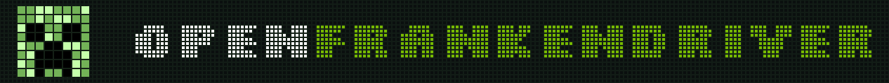

<div align="center">

[](#)
[](README_EN.md)

<br>

<a href="https://github.com/lnp/OpenFrankenDriver"></a>
<br>

**Полностью открытый, бесплатный и безопасный драйвер NVIDIA для китайских видеокарт-мутантов**  
*(RTX 4070m, RTX 4060m, RTX 3070m, RTX 3060m, RTX 2060m, GTX 1660m и ещё 65 моделей на базе мобильных чипов AD106/GA104/GA106/TU106)*

[](LICENSE)
[](https://www.nvidia.com)
[](docs/ARCHITECTURE.md)
[-0078D6?logo=windows)](docs/SUPPORTED_DEVICES.md)
[](https://boosty.to/defrag)

---

<table>
  <thead>
    <tr>
      <th width="38%">&nbsp;OpenFrankenDriver&nbsp;621.35.1</th>
      <th width="62%">📋 Что нового в версии 621.35.1</th>
    </tr>
  </thead>
  <tbody>
    <tr>
      <td valign="top">
        <br><a href="https://disk.yandex.ru/d/Qr8Z-BdUQEUn1w"><b>Скачать с Яндекс Диска (~1.02 ГБ)</b></a><br><br>
        • <b>Версия:</b> 621.35.1 Hotfix (защита SSD &amp; деблоат)<br>
        • <b>ОС:</b> Windows 10 &amp; 11 (26H2+)<br>
        • <b>Zero-Touch:</b> автоустановка сертификата<br>
        • Встроена автономная Панель управления Win32<br><br>
      </td>
      <td valign="top">
        ✨ <b>Переход на базу 621.35 Hotfix &amp; защита накопителя</b>:<br>
        В официальном хотфиксе NVIDIA 621.35 устранён критический баг #7116722 с непрерывной перезаписью файла лога <code>nvlog.nvlgstg</code> процессом контейнера (<code>NVDisplay.Container.exe</code>).<br><br>
        В инсталлятор OpenFrankenDriver 621.35.1 дополнительно сохранена превентивная нативная защита (DisableLoad=1 для фоновой службы телеметрии <code>_nvtopps</code>), которая полностью устраняет паразитный I/O-износ SSD и освобождает ресурсы процессора.
      </td>
    </tr>
    <tr>
      <td colspan="2" align="center">
        <br>
        <a href="https://boosty.to/defrag"></a>
        <br><br>
        <sub>Проект развивается на чистом энтузиазме. Драйверы и скрипты сборки всегда будут полностью открытыми и бесплатными.<br>
        Если сборка сэкономила вам время, оживила вашу видеокарту и избавила от танцев с бубном — вы можете <a href="https://boosty.to/defrag"><b>добровольно поддержать разработку на Boosty</b></a>.</sub>
        <br><br>
      </td>
    </tr>
  </tbody>
</table>

---

[**Поддерживаемые видеокарты**](docs/SUPPORTED_DEVICES.md) • [**Инструкция по модификации**](#-как-модифицировать-оригинальный-драйвер-инструкция) • [**Архитектура**](docs/ARCHITECTURE.md) • [**Решение проблем**](docs/TROUBLESHOOTING.md)

</div>

---

## 🚀 Почему OpenFrankenDriver? (Преимущества перед оригиналом)

Оригинальный проект **FrankenDriver** (`arutar/FrankenDriver`) долгое время был популярным решением для запуска китайских карт с мобильными чипами. Однако оригинальный репозиторий **не является open-source** (в нём нет исходного кода и скриптов), его бесплатные версии давно устарели, а свежие сборки распространяются по платной подписке на Boosty.

**OpenFrankenDriver** — открытая, бесплатная и технически доработанная альтернатива оригинальному проекту:

| Возможность / Параметр | Оригинальный FrankenDriver |  |
|---|---|---|
| **Открытость и прозрачность** | ❌ Закрытый бинарник. Репозиторий пуст, исходного кода нет. | ✅ **100% Open-Source**. Весь пайплайн сборки и исходники открыты. |
| **Доступность версий** | ❌ Свежие версии закрыты за платным пейволлом. | ✅ **Всегда бесплатно**. Актуальная стабильная ветка **621.35 Hotfix**. |
| **Установка в 1 клик (Zero-Touch)** | ❌ Красное окно Windows Security («Издатель не проверен»). Требовалась ручная установка сертификата. | ✅ **Тихая автоматическая регистрация**. Сертификат сам импортируется в `Root` и `TrustedPublisher`. Никаких красных окон. |
| **Классическая Панель управления** | ❌ На чистой Windows или лёгких сборках панель отсутствует (требовался Microsoft Store и интернет). | ✅ **Встроена автономная Win32-панель** (`nvcplui.exe`). Работает из коробки на Windows LTSC и Compact без Store и без сети. |
| **Безопасность и античиты** | ❓ Закрытые бинарники вызывали вопросы у пользователей. | ✅ **Оригинальные нетронутые ядра NVIDIA**. 100% WHQL-целостность, чистый тест `signtool`, `testsigning No`, полная работа EAC / BattlEye / CS2. |

---

## 💾 Быстрая установка (Для пользователей)

1. **Скачайте готовый установщик** по ссылке в таблице выше или с [Яндекс Диска](https://disk.yandex.ru/d/Qr8Z-BdUQEUn1w).
2. *(Рекомендуется)* Если вы обновляетесь со старых версий или меняли видеокарту, удалите предыдущий драйвер через **DDU (Display Driver Uninstaller)** в безопасном режиме.
3. Запустите скачанный `.exe` файл.
4. Выберите **«Графический драйвер NVIDIA»** и нажмите **«Далее»**.
5. По завершении установки видеокарта определится без «Ошибки 43», а на рабочем столе и в контекстном меню сразу появится рабочая **Панель управления NVIDIA**.

---

## 🛠️ Как модифицировать оригинальный драйвер (Инструкция)

Вы можете в любой момент взять любой официальный чистый драйвер NVIDIA с официального сайта и самостоятельно получить модифицированный драйвер OpenFrankenDriver.

### Способ 1: Автоматическая сборка скриптом (Рекомендуется)

1. Установите Python 3.10+ и зависимости:
   ```cmd
   pip install pefile
   ```
2. Скачайте официальный драйвер NVIDIA (ветки 621.xx WHQL или новее) с сайта NVIDIA.
3. Запустите автоматический мастер сборки:
   ```cmd
   python scripts/build.py --nvidia-exe "путь\к\официальному_инсталлятору.exe"
   ```
   Скрипт автоматически:
   - Распакует инсталлятор;
   - Внедрит 71 конфигурацию видеокарт-мутантов в секции `17134` (Win10) и `26200` (Win11 26H2);
   - Устранит блокировку драйвера и снимет код ошибки 43 (`RM1457588`);
   - Пересоберёт и подпишет сертификатом безопасности каталог `nv_disp.cat` с официальной меткой времени DigiCert;
   - Интегрирует автономную классическую Панель управления (`nvcplui.exe`);
   - Запакует готовый монолитный SFX-инсталлятор.

---

### Способ 2: Ручная модификация

Если вы хотите внести изменения вручную:

1. **Распаковка инсталлятора**:
   Распакуйте официальный файл инсталлятора NVIDIA через 7-Zip в любую папку.

2. **Модификация INF-файла**:
   - Откройте `Display.Driver\nv_dispi.inf`;
   - Найдите секции `[NVIDIA_Devices.NTamd64.10.0...17134]` и `[NVIDIA_Devices.NTamd64.10.0...26200]`;
   - Добавьте строки идентификаторов ваших видеокарт из справочника [`data/devices.json`](data/devices.json);
   - Убедитесь, что в блоке параметров указан флаг отключения аппаратной блокировки (снятие Code 43):
     ```ini
     HKR,,RM1457588,%REG_DWORD%,1
     ```

3. **Создание и подпись каталога безопасности (`nv_disp.cat`)**:
   - Сгенерируйте файл списка файлов (`nv_disp.cdf`) для папки `Display.Driver`;
   - Скомпилируйте каталог через утилиту Windows SDK:
     ```cmd
     makecat -v nv_disp.cdf
     ```
   - Подпишите созданный каталог через `signtool.exe` с добавлением RFC3161 метки времени (DigiCert):
     ```cmd
     signtool sign /f certs/OpenFrankenDriver.pfx /p 1234 /fd SHA256 /tr http://timestamp.digicert.com /td SHA256 nv_disp.cat
     ```
   - Скопируйте готовый `nv_disp.cat` в подпапку `EACSupport\` (для совместимости с Easy Anti-Cheat).

4. **Интеграция Панели управления**:
   - Создайте подпапку `Display.NVCPL`;
   - Извлеките исполняемые файлы (`nvcplui.exe`, `nvcpluir.dll`, `NvGpuUtilization.exe`, `nvImage.dll`) из архива `Display.Driver\NVCPL\*.appx`;
   - Добавьте файл конфигурации пакета `NVCPL.nvi` и нативный помощник развёртывания `install_helper.exe`.

5. **Сборка монолитного установщика**:
   - Запакуйте все папки через 7-Zip в архив `payload.7z` с ультра-сжатием LZMA2;
   - Присоедините официальный запускающий стаб `PackageLauncher.exe` к полученному архиву;
   - Подпишите финальный `.exe` файл цифровой подписью проекта.

---

## 🔒 Безопасность и проверка целостности

OpenFrankenDriver принципиально отличается от закрытых сборок:
- В пакете **нет сторонних или модифицированных dll/sys файлов драйвера** — все бинарники (`nvlddmkm.sys`, библиотеки DirectX/Vulkan/CUDA) взяты напрямую из официального пакета NVIDIA WHQL;
- Драйвер не требует включения небезопасного тестового режима Windows (`bcdedit /set testsigning on`);
- Античиты **Easy Anti-Cheat (Apex Legends, Fortnite)**, **BattlEye (R6 Siege)**, **VAC (CS2)** и **Vanguard (Valorant)** работают в штатном режиме, так как модуль ядра NVIDIA полностью аутентичен и подписан.

---

## 🤝 Содействие проекту и обратная связь

Если вашей видеокарты ещё нет в списке поддерживаемых, создайте [Issue](https://github.com/lnp/OpenFrankenDriver/issues) с указанием Hardware ID (из Диспетчера устройств) и скриншотом GPU-Z. Мы оперативно добавим поддержку в базу.

---

## 📄 Лицензия

Исходные скрипты сборки, база данных устройств и конфигурации распространяются под свободной лицензией **MIT**. Исполняемые файлы и драйверы NVIDIA являются собственностью компании NVIDIA Corporation.
