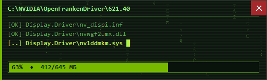
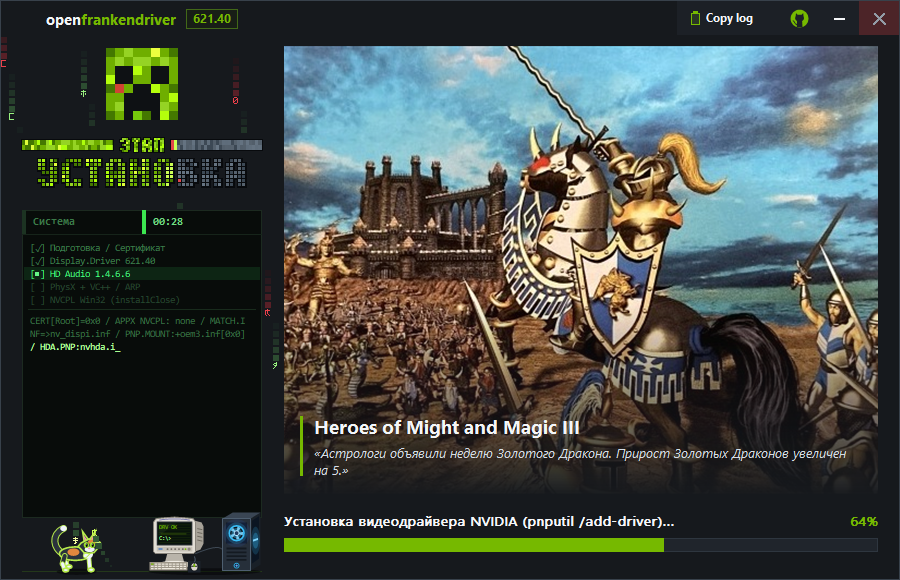

<div align="center">

[](#)
[](README_EN.md)

<br>

<a href="https://github.com/lnp/OpenFrankenDriver"></a>
<br>

**Открытый нативный драйвер NVIDIA с установщиком на Rust для мобильно-десктопных видеокарт-мутантов**  
*(RTX 4070m, RTX 4060m, RTX 3070m, RTX 3060m, RTX 2060m, GTX 1660m и ещё 65+ моделей на чипах AD106/GA104/GA106/TU106)*

[](LICENSE)
[](https://www.nvidia.com)
[](docs/ARCHITECTURE.md)
[-0078D6?logo=windows)](docs/SUPPORTED_DEVICES.md)

<br>

<a href="https://disk.yandex.ru/d/Pcw3GemKN-cOfQ"></a>&nbsp;&nbsp;&nbsp;<a href="https://boosty.to/defrag"></a>

<br><br>

[**Коренные преимущества v2**](#-коренные-преимущества-openfrankendriver-v2) • [**Быстрая установка**](#-быстрая-установка) • [**Сборка с нуля**](#️-как-собрать-драйвер-самостоятельно) • [**Видеокарты**](docs/SUPPORTED_DEVICES.md) • [**Архитектура**](docs/ARCHITECTURE.md) • [**Разбор NVI2**](docs/INSTALLER_REVERSE_ENGINEERING.md) • [**Проблемы**](docs/TROUBLESHOOTING.md)

</div>

---

## ⚡ Коренные преимущества OpenFrankenDriver v2

В ветке **v2** мы полностью вырезали проприетарный установщик NVIDIA (`PackageLauncher.exe`, `NVI2.dll`, `NVI2UI.dll`), `NVIDIA App` и телеметрию, заменив их двумя открытыми нативными Win32-бинарниками на **Rust** (`src/sfx_rust` + `src/setup_rust`) без единого браузерного движка.

### Почему официальный установщик NVIDIA (`NVI2`) тормозил по 4–5 минут
- **32-битный COM + встроенный Internet Explorer (`MSHTML`):** при разборе `NVI2UI.DLL` видно, что весь установщик NVIDIA до сих пор 32-битный (`x86`), а экран прогресса рисуется через ActiveX-хост `CAxHostWindow` (`AtlAxWin140`) с **Internet Explorer** (`CLSID_WebBrowser`, `urlmon.dll`), который при старте пытается тянуть промо-HTML с `gfwsl.geforce.com` в `<iframe>`. Полный пакет вдобавок навязывает **NVIDIA App (`libcef.dll` / Chromium CEF)** и службы телеметрии.
- **Парсинг 43 чужих `.inf` (> 50 МБ) до старта:** вместо прямой установки нужного драйвера `DisplayDriverExt.dll` поддерживает кэш в `Installer2`, гоняет криптопроверки и в одном потоке перебирает десятки мегабайт ноутбучных INF-файлов (`nvlti.inf`, `nvdmi.inf`, `nvami.inf` и др.), из-за чего инсталлятор «думает» по **1.5–3 минуты ещё до начала установки**.

### Что даёт OpenFrankenDriver v2 на Rust
| Параметр | Штатный `NVI2` + полный пакет NVIDIA | **OpenFrankenDriver v2 Beta** |
|---|---|---|
| **Время установки** | ~4–5 минут (1.5–3 мин пауза на парсинге INF) | ✅ **~77–86 секунд** *(распаковка `3.24 ГБ` за `~4.7 с` через `sevenz-turbo`)* |
| **Размер дистрибутива** | ~1.15 ГБ и выше (учёт `NVI2` / `NvApp`) | ✅ **`~969 МБ` (`0.95 ГБ`)** без потери нужных модулей |
| **Движок UI** | 32-bit x86 COM + `IE/MSHTML` + `CEF` (`NVIDIA App`) | ✅ **Чистый нативный Rust + Win32 GDI/GDI+**, 0 браузеров, 0 сети |
| **Телеметрия и мусор** | `NvTelemetry`, `_nvtopps` (баг износа SSD), `NvApp` | ✅ **Вырезано из коробки**, `_nvtopps DisableLoad=1` |
| **Панель управления** | UWP из Microsoft Store (нет на LTSC / Compact) | ✅ **Классическая Win32 `nvcplui.exe`** — работает офлайн везде |
| **Видеокарты-мутанты** | Ошибка 43 на мобильных чипах на десктопе | ✅ **70+ моделей + `RM1457588=1`** + опциональный `NVPI v3.0.2.1` |
| **Античиты и WHQL** | Официальный WHQL | ✅ **100% оригинальное ядро `nvlddmkm.sys`**, `testsigning No`, **EAC / BattlEye / Vanguard / VAC / FaceIT** |

<details>
<summary><b>📸 Скриншоты нативного Rust-установщика v2 (распаковщик 03E и окно установки)</b></summary>
<br>
<div align="center">
  
  <br><br>
  
</div>
</details>

---

## 💾 Быстрая установка

1. **Скачайте установщик** по кнопке в шапке или прямой ссылке: [Яндекс Диск (~969 МБ)](https://disk.yandex.ru/d/Pcw3GemKN-cOfQ).
2. *(Рекомендуется при переходе со старых/битых сборок)* Удалите предыдущий драйвер через **DDU (Display Driver Uninstaller)** в безопасном режиме.
3. Запустите скачанный `OpenFrankenDriver_v2_Beta_621.40.exe` *(при срабатывании Windows SmartScreen нажмите «Подробнее» → «Выполнить в любом случае» — пакет подписан локальным сертификатом проекта)*.
4. Распаковка пройдёт за **~5 секунд**, после чего откроется окно установщика: выберите нужные компоненты (драйвер + Win32 Панель управления, HD Audio, PhysX, VC++ Runtime, при желании **Чистую установку** и **NVIDIA Profile Inspector v3.0.2.1**) и нажмите **«Установить»**.
5. Через **~1.5 минуты** драйвер встанет без Ошибки 43 и предупреждений безопасности, а классическая **Панель управления NVIDIA** появится в контекстном меню рабочего стола и в меню «Пуск».

> Поддерживаются тихие ключи CLI: `--silent` (автоустановка без окон), `--clean` (чистая установка), `--nvpi` (добавить Profile Inspector), `--uninstall` (полное удаление). Подробная диагностика и удаление описаны в [TROUBLESHOOTING.md](docs/TROUBLESHOOTING.md).

---

## 🛠️ Как собрать драйвер самостоятельно

Вы можете взять любой официальный чистый установщик NVIDIA DCH WHQL с nvidia.com и собрать собственный пакет OpenFrankenDriver из открытых исходников.

### Способ 1: Автоматическая сборка скриптом (Рекомендуется)

1. Установите зависимости: **Python 3.10+** (`pip install pefile Pillow`), **7-Zip**, **Windows 10/11 SDK** (`makecat.exe`, `signtool.exe`), а для сборки нативного установщика v2 (`--beta-installer`) — **Rust (`cargo` / `rustc` MSVC)**.
2. Скачайте чистый драйвер NVIDIA WHQL с сайта NVIDIA.
3. Запустите сборку **v2 Beta (нативный Rust-установщик без `NVI2`)**:
   ```cmd
   python scripts/build.py --nvidia-exe "путь\к\официальному_драйверу.exe" --beta-installer
   ```
   *(Для классической сборки 1.x с `NVI2` запустите без `--beta-installer`, с флагом `--slim` для вырезания `NVIDIA App`/телеметрии.)*

   Скрипт автоматически:
   - Распакует официальный драйвер и удалит конфликтующий `NVPCF`;
   - Внедрит **70+ конфигураций видеокарт-мутантов** из [`data/devices.json`](data/devices.json) с динамическим определением INF-секций (`17134` / `26200`) и фиксом Ошибки 43 (`RM1457588=1`);
   - Пересоберёт и подпишет каталог безопасности `nv_disp.cat` со штампом времени RFC3161 DigiCert (включая расшифровку сжатых DLSS-библиотек перед хешированием);
   - Извлечёт автономную Win32 Панель управления (`nvcplui.exe`) из `NVCPL\*.appx`;
   - Выполнит **Smoke Check** и **Phase Guard** `.nvi`-фаз, скомпилирует [`src/setup_rust`](src/setup_rust) и [`src/sfx_rust`](src/sfx_rust), запакует монолитный `.exe` и проверит подпись через `signtool verify /pa`.

---

### Способ 2: Ручная сборка шаг за шагом (пайплайн v2 и 1.x)

1. **Распаковка исходного пакета NVIDIA**:
   Распакуйте официальный `.exe` от NVIDIA через 7-Zip в рабочую папку, удалите `NVPCF` (ноутбучный контроллер питания) и расшифруйте сжатые DLSS-библиотеки при наличии (`expand Display.Driver\ngx-builtins\nvngx_dlssd.dl_ Display.Driver\ngx-builtins\nvngx_dlssd.dll`).

2. **Модификация `Display.Driver\nv_dispi.inf`**:
   - Найдите секции `[NVIDIA_Devices.NTamd64.10.0...17134]` и `[NVIDIA_Devices.NTamd64.10.0...26200]` и добавьте строки Hardware ID из [`data/devices.json`](data/devices.json);
   - В секции `nv_miscBase_addreg__*` добавьте параметр снятия Ошибки 43:
     ```ini
     HKR,,RM1457588,%REG_DWORD%,1
     ```

3. **Генерация и подпись каталога безопасности (`nv_disp.cat`)**:
   - Сформируйте список файлов `nv_disp.cdf` для папки `Display.Driver`;
   - Соберите каталог и подпишите его с меткой времени DigiCert:
     ```cmd
     makecat -v nv_disp.cdf
     signtool sign /f certs/OpenFrankenDriver.pfx /p 1234 /fd SHA256 /tr http://timestamp.digicert.com /td SHA256 nv_disp.cat
     ```

4. **Извлечение Win32 Панели управления (`Display.NVCPL`)**:
   Извлеките `nvcplui.exe`, `nvcpluir.dll`, `NvGpuUtilization.exe`, `nvImage.dll`, `EULA.txt` из `Display.Driver\NVCPL\*.appx` в каталог `Display.NVCPL` (в ветке v2 деплой, ярлыки и ветки реестра `EnableNvcplUIOnDCH` выполняет сам `setup.exe`, в ветке 1.x используется `NVCPL.nvi` + `install_helper.exe`).

5. **Сборка нативных Rust-бинарников и финального `.exe` (v2 Beta)**:
   - Соберите `setup.exe` и `sfx_stub.exe`:
     ```cmd
     cargo build --release --manifest-path src/setup_rust/Cargo.toml
     cargo build --release --manifest-path src/sfx_rust/Cargo.toml
     ```
   - Подготовьте стейджинг-папку (`Display.Driver`, `Display.NVCPL`, `HDAudio`, `PhysX` с `physx_manifest.json`, `Showcase`, сертификат `OpenFrankenDriver.cer`, `setup.exe`), запакуйте в `payload.7z` (`-m0=LZMA2:d24 -mf=off -mx=4 -ms=on`) и соберите монолитный подписанный `.exe` через `scripts/beta_builder.py` (подробнее — в [HOW_TO_BUILD.md](docs/HOW_TO_BUILD.md) и [ARCHITECTURE.md](docs/ARCHITECTURE.md)).

---

## 🔒 Безопасность и целостность WHQL

- **Нет патченных бинарников ядра:** `nvlddmkm.sys`, библиотеки DirectX, Vulkan, CUDA и OpenCL на 100% байт-в-байт идентичны официальному WHQL-выпуску NVIDIA.
- **Без тестового режима Windows:** `bcdedit /set testsigning on` не используется никогда.
- **Полная совместимость с античитами:** **Easy Anti-Cheat**, **BattlEye**, **Riot Vanguard**, **Valve Anti-Cheat (CS2)** и **FaceIT** проходят проверку подписи ядра штатно.

---

## 🤝 Содействие проекту и обратная связь

Если вашей видеокарты ещё нет в списке [поддерживаемых устройств](docs/SUPPORTED_DEVICES.md), откройте [Issue](https://github.com/lnp/OpenFrankenDriver/issues), приложите Hardware ID из Диспетчера устройств и скриншот GPU-Z — добавим поддержку в базу.

---

## 📄 Лицензия

Исходный код установщика, SFX-распаковщика, скриптов сборки и база устройств распространяются под лицензией **MIT** ([LICENSE](LICENSE)). Бинарные драйверы NVIDIA являются собственностью NVIDIA Corporation.
