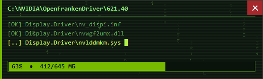
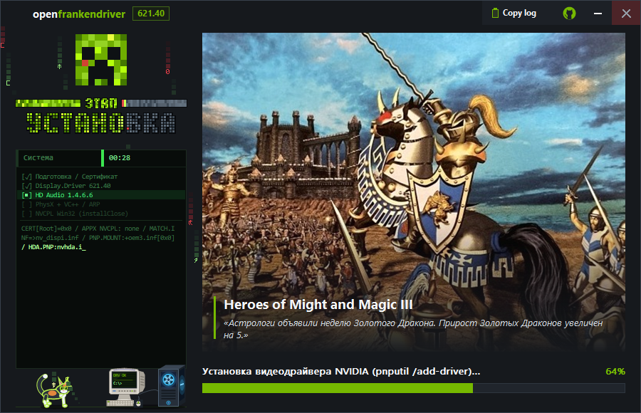

<div align="center">

[](README.md)
[](#)

<br>

<a href="https://github.com/lnp/OpenFrankenDriver"></a>
<br>

**Open-source native NVIDIA driver & pure-Rust installer for mobile-on-desktop mutant GPUs**  
*(RTX 4070m, RTX 4060m, RTX 3070m, RTX 3060m, RTX 2060m, GTX 1660m and 65+ other AD106/GA104/GA106/TU106 models)*

[](LICENSE)
[](https://www.nvidia.com)
[](docs/ARCHITECTURE.md)
[-0078D6?logo=windows)](docs/SUPPORTED_DEVICES.md)

<br>

<a href="https://disk.yandex.ru/d/Pcw3GemKN-cOfQ"></a>&nbsp;&nbsp;&nbsp;<a href="https://boosty.to/defrag"></a>

<br><br>

[**Core v2 Advantages**](#-core-advantages-of-openfrankendriver-v2) • [**Quick Install**](#-quick-install) • [**Build From Source**](#️-how-to-build-from-official-nvidia-drivers) • [**Supported GPUs**](docs/SUPPORTED_DEVICES.md) • [**Architecture**](docs/ARCHITECTURE.md) • [**NVI2 Reversing**](docs/INSTALLER_REVERSE_ENGINEERING.md) • [**Troubleshooting**](docs/TROUBLESHOOTING.md)

</div>

---

## ⚡ Core Advantages of OpenFrankenDriver v2

Starting with **v2**, OpenFrankenDriver completely removes NVIDIA's proprietary installer wrappers (`PackageLauncher.exe`, `NVI2.dll`, `NVI2UI.dll`), `NVIDIA App`, and telemetry — replacing them with two open-source native Win32 binaries written in **Rust** (`src/sfx_rust` + `src/setup_rust`) with zero browser engines.

### Why NVIDIA's Official Installer (`NVI2`) Took 4–5 Minutes
- **32-bit COM + Embedded Internet Explorer (`MSHTML`):** Binary inspection of `NVI2UI.DLL` shows the stock installer is still 32-bit `x86`, rendering its progress screen via `CAxHostWindow` (`AtlAxWin140`) hosting **Internet Explorer** (`CLSID_WebBrowser`, `urlmon.dll`) that tries to pull promotional HTML from `gfwsl.geforce.com` in an `<iframe>`. Full NVIDIA packages additionally push **NVIDIA App (`libcef.dll` / Chromium CEF)** and telemetry services.
- **Parsing 43 Foreign `.inf` Files (> 50 MB) Before Staging:** Before actually installing the display driver, `DisplayDriverExt.dll` maintains an `Installer2` cache, runs trust checks, and single-threadedly parses tens of megabytes of unrelated laptop INF files (`nvlti.inf`, `nvdmi.inf`, `nvami.inf`, etc.) — stalling for **1.5–3 minutes before installation even begins**.

### What OpenFrankenDriver v2 Delivers
| Metric | Stock `NVI2` + Full NVIDIA Package | **OpenFrankenDriver v2 Beta** |
|---|---|---|
| **Install Duration** | ~4–5 minutes (1.5–3 min INF parsing freeze) | ✅ **~77–86 seconds** *(unpacks `3.24 GB` in `~4.7 s` via `sevenz-turbo`)* |
| **Installer Size** | ~1.15 GB+ (including `NVI2` / `NvApp` bloat) | ✅ **`~969 MB` (`0.95 GB`)** with every required module kept |
| **UI Engine** | 32-bit x86 COM + `IE/MSHTML` + `CEF` (`NVIDIA App`) | ✅ **Pure native Rust + Win32 GDI/GDI+**, zero browsers, zero network calls |
| **Telemetry & Bloat** | `NvTelemetry`, `_nvtopps` (SSD wear bug), `NvApp` | ✅ **Stripped cleanly out of the box**, `_nvtopps DisableLoad=1` |
| **Control Panel** | MS Store UWP (missing on Windows LTSC / Compact) | ✅ **Standalone Classic Win32 `nvcplui.exe`** — works offline everywhere |
| **Mutant GPU Support** | Code 43 block on mobile silicon on desktop PCIe | ✅ **70+ GPUs + `RM1457588=1`** + optional `NVPI v3.0.2.1` |
| **WHQL & Anti-Cheats** | Official WHQL | ✅ **100% untouched `nvlddmkm.sys` kernel**, `testsigning No`, **EAC / BattlEye / Vanguard / VAC / FaceIT** |

<details>
<summary><b>📸 Native Rust v2 Installer Screenshots (03E Unpacker & Setup GUI)</b></summary>
<br>
<div align="center">
  
  <br><br>
  
</div>
</details>

---

## 💾 Quick Install

1. **Download the installer** using the button above or directly via [Yandex Disk (~969 MB)](https://disk.yandex.ru/d/Pcw3GemKN-cOfQ).
2. *(Recommended if switching from older/broken drivers)* Run **DDU (Display Driver Uninstaller)** in Windows Safe Mode first.
3. Launch `OpenFrankenDriver_v2_Beta_621.40.exe` *(if Windows SmartScreen prompts, click **More info → Run anyway** — the package is signed with the project's local code-signing certificate)*.
4. Unpacking finishes in **~5 seconds**, opening the setup GUI: select components (Driver + Win32 Control Panel, HD Audio, PhysX, VC++ Runtime, optional **Clean Install**, optional **NVIDIA Profile Inspector v3.0.2.1**) and click **Install**.
5. In **~1.5 minutes**, your mutant GPU initializes cleanly without Code 43 or red security popups, with classic **NVIDIA Control Panel** added to your desktop context menu and Start Menu.

> Unattended CLI flags are supported: `--silent`, `--clean`, `--nvpi`, `--uninstall`. See [TROUBLESHOOTING.md](docs/TROUBLESHOOTING.md) for diagnostics and removal details.

---

## 🛠️ How to Build From Official NVIDIA Drivers

You can build OpenFrankenDriver cleanly from any official NVIDIA DCH WHQL installer downloaded from nvidia.com.

### Method 1: Automated Build Script (Recommended)

1. Prerequisites: **Python 3.10+** (`pip install pefile Pillow`), **7-Zip**, **Windows 10/11 SDK** (`makecat.exe`, `signtool.exe`), and **Rust (`cargo` / `rustc` MSVC)** when building the v2 native installer (`--beta-installer`).
2. Download an official clean NVIDIA WHQL installer from nvidia.com.
3. Run **v2 Beta build (pure-Rust installer, zero `NVI2`)**:
   ```cmd
   python scripts/build.py --nvidia-exe "path\to\official_driver.exe" --beta-installer
   ```
   *(Omit `--beta-installer` for legacy 1.x `NVI2` packaging; add `--slim` to strip `NVIDIA App`/telemetry in 1.x mode.)*

   The builder automatically:
   - Extracts the official package and removes conflicting laptop `NVPCF` drivers;
   - Injects **70+ mutant GPU entries** from [`data/devices.json`](data/devices.json) with dynamic INF `SectionXXX` resolution (`17134` & `26200`) and Code 43 bypass (`RM1457588=1`);
   - Compiles and signs `nv_disp.cat` with an RFC3161 DigiCert timestamp (expanding compressed DLSS payloads prior to hashing);
   - Extracts the standalone Win32 Control Panel (`nvcplui.exe`) from `NVCPL\*.appx`;
   - Runs **Smoke Checks** and `.nvi` **Phase Guard**, compiles [`src/setup_rust`](src/setup_rust) and [`src/sfx_rust`](src/sfx_rust), packs the monolithic `.exe`, and verifies signatures via `signtool verify /pa`.

---

### Method 2: Manual Step-by-Step Modification (v2 & 1.x Pipeline)

1. **Extract Official Package**:
   Unpack the NVIDIA `.exe` with 7-Zip, delete `NVPCF`, and expand compressed DLSS binaries if present (`expand Display.Driver\ngx-builtins\nvngx_dlssd.dl_ Display.Driver\ngx-builtins\nvngx_dlssd.dll`).

2. **Patch `Display.Driver\nv_dispi.inf`**:
   - Locate `[NVIDIA_Devices.NTamd64.10.0...17134]` and `[NVIDIA_Devices.NTamd64.10.0...26200]` and append device rows from [`data/devices.json`](data/devices.json);
   - Append the Code 43 fix inside `nv_miscBase_addreg__*` sections:
     ```ini
     HKR,,RM1457588,%REG_DWORD%,1
     ```

3. **Generate & Sign Security Catalog (`nv_disp.cat`)**:
   - Build `nv_disp.cdf` covering `Display.Driver`;
   - Compile and sign with DigiCert RFC3161 timestamp:
     ```cmd
     makecat -v nv_disp.cdf
     signtool sign /f certs/OpenFrankenDriver.pfx /p 1234 /fd SHA256 /tr http://timestamp.digicert.com /td SHA256 nv_disp.cat
     ```

4. **Extract Win32 Control Panel (`Display.NVCPL`)**:
   Extract `nvcplui.exe`, `nvcpluir.dll`, `NvGpuUtilization.exe`, `nvImage.dll`, and `EULA.txt` from `Display.Driver\NVCPL\*.appx` into `Display.NVCPL` (in v2, `setup.exe` handles deployment, shortcuts, and `EnableNvcplUIOnDCH` directly; 1.x uses `NVCPL.nvi` + `install_helper.exe`).

5. **Compile Rust Binaries & Package Final `.exe` (v2 Beta)**:
   - Build `setup.exe` and `sfx_stub.exe`:
     ```cmd
     cargo build --release --manifest-path src/setup_rust/Cargo.toml
     cargo build --release --manifest-path src/sfx_rust/Cargo.toml
     ```
   - Assemble the staged payload (`Display.Driver`, `Display.NVCPL`, `HDAudio`, `PhysX` with `physx_manifest.json`, `Showcase`, `OpenFrankenDriver.cer`, `setup.exe`), pack `payload.7z` (`-m0=LZMA2:d24 -mf=off -mx=4 -ms=on`), and attach + sign via `scripts/beta_builder.py` (see [HOW_TO_BUILD.md](docs/HOW_TO_BUILD.md) and [ARCHITECTURE.md](docs/ARCHITECTURE.md)).

---

## 🔒 Security & WHQL Integrity

- **Zero patched kernel binaries:** `nvlddmkm.sys`, DirectX, Vulkan, CUDA, and OpenCL libraries remain byte-for-byte identical to the official NVIDIA WHQL package.
- **No `testsigning` mode:** `bcdedit /set testsigning on` is never enabled.
- **Full anti-cheat compatibility:** **Easy Anti-Cheat**, **BattlEye**, **Riot Vanguard**, **VAC (CS2)**, and **FaceIT** operate cleanly without driver signature issues.

---

## 🤝 Contributing & Hardware Submissions

If your mutant card is missing from [Supported Hardware](docs/SUPPORTED_DEVICES.md), open an [Issue](https://github.com/lnp/OpenFrankenDriver/issues) with its Hardware ID (from Device Manager) and a GPU-Z screenshot.

---

## 📄 License

The native installer, SFX launcher, build scripts, and device database are licensed under the **MIT License** ([LICENSE](LICENSE)). NVIDIA driver binaries remain property of NVIDIA Corporation.
